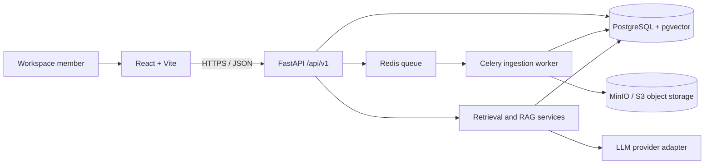

# Architecture

## Context

The browser client calls a versioned FastAPI service. The API owns identity, workspace authorization, document metadata, chat records, and orchestration. Passwords are stored as Argon2 hashes; access tokens are short-lived and each authenticated request checks the associated revocable session. Long-running ingestion work is sent to Celery through Redis. PostgreSQL stores application data and vectors; an S3-compatible service stores original files.

## Document ingestion

1. The API authenticates the user, checks workspace membership, and requires the editor or owner role.
2. It validates PDF/DOCX structure and size, stores the original in a private bucket, creates a `documents` row with `queued` status, and enqueues an ingestion job.
3. A Celery worker downloads the object, extracts PDF or DOCX text, and marks the document `processing`.
4. Extracted source units are stored in PostgreSQL. PDF units preserve the 1-based page number; DOCX is stored as one unit without a page number.
5. Chunking and embeddings will be added after source extraction, keeping the ingestion stages independently testable.
6. Invalid input produces a safe, user-visible `failed` status. Transient storage/worker failures retry with backoff and become failed after the retry limit.

## Question answering

1. The API validates workspace membership before accepting the query.
2. The embedding adapter encodes the question with the same model and preprocessing used for document chunks.
3. Retrieval searches only chunks in the requested workspace. Candidate passages may be reranked with a cross-encoder.
4. The answer service sends a bounded set of passages to the configured LLM, with instructions to use only the supplied evidence and return structured citations.
5. The API validates that every cited chunk belongs to the workspace and maps citations to document names and pages before returning the response.
6. If retrieval finds insufficient evidence, return that outcome instead of presenting an unsupported answer as fact.

## Trust boundaries and safeguards

- The API is the authorization boundary; frontend filtering is never relied on for access control.
- Every document, chunk, conversation, and source lookup is scoped to an authorized workspace.
- Uploaded files and extracted text are untrusted. Treat document content as data, not as instructions to the assistant.
- Do not expose object-store credentials or raw internal errors to clients.
- Keep provider credentials in environment configuration and redact them from logs.

## Deployment shape

Local development will use Docker Compose for PostgreSQL, Redis, and MinIO. The API, worker, and frontend can run as separate processes. Production deployment can replace MinIO with S3-compatible storage and use managed PostgreSQL/Redis without changing application boundaries.

## Decisions to revisit with evidence

Chunk size and overlap, retrieval metric, top-k, reranking depth, embedding model, LLM provider, and storage limits should be selected using a fixed evaluation set and operational constraints, not treated as universal constants.
