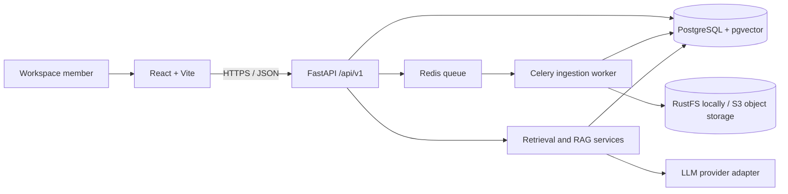

# Architecture

## Context

The browser client calls a versioned FastAPI service. The API owns identity, workspace authorization, document metadata, chat records, and orchestration. Passwords are stored as Argon2 hashes; access tokens are short-lived and each authenticated request checks the associated revocable session. Long-running ingestion work is sent to Celery through Redis. PostgreSQL stores application data and vectors; an S3-compatible service stores original files.

## Document ingestion

1. The API authenticates the user, checks workspace membership, and requires the editor or owner role.
2. It validates PDF/DOCX structure and size, stores the original in a private bucket, creates a `documents` row with `queued` status, and enqueues an ingestion job.
3. A Celery worker downloads the object, extracts PDF or DOCX text, and marks the document `processing`.
4. Extracted source units are stored in PostgreSQL. PDF units preserve the 1-based page number; DOCX is stored as one unit without a page number.
5. Each page/source unit is split into overlapping tokenizer windows. The embedding model creates normalized vectors, which are stored with document, workspace, page, and model metadata in pgvector.
6. Invalid input or permanent model configuration errors produce a safe, user-visible `failed` status. Transient storage/model download failures retry with backoff and become failed after the retry limit.

The initial search uses exact cosine-distance ordering in PostgreSQL. Add an approximate vector index only after measuring corpus size, filtered recall, and query latency; workspace filters must remain part of every retrieval query.

## Question answering

1. The API validates workspace membership before accepting the query.
2. The embedding adapter encodes the question with the same model and preprocessing used for document chunks.
3. Retrieval searches only chunks in the requested workspace. Candidate passages may be reranked with a cross-encoder.
4. The answer service sends a bounded set of passages and recent conversation turns to the configured OpenAI-compatible provider. Retrieved passage text is explicitly treated as untrusted data; the provider returns structured answer text and chunk IDs.
5. The API accepts citation IDs only from the retrieved candidate set and maps those chunks to document names and source page metadata before returning the response.
6. If no passage meets the configured relevance threshold, return and persist an insufficient-evidence outcome without calling the provider.

Conversation rows are private to their creating user within the workspace. Every history read and question request checks both workspace membership and conversation ownership. `LLM_API_KEY` is optional for search and insufficient-evidence responses, but required when generation is needed.

## Trust boundaries and safeguards

- The API is the authorization boundary; frontend filtering is never relied on for access control.
- Every document, chunk, conversation, and source lookup is scoped to an authorized workspace.
- Uploaded files and extracted text are untrusted. Treat document content as data, not as instructions to the assistant.
- Do not expose object-store credentials or raw internal errors to clients.
- Keep provider credentials in environment configuration and redact them from logs.

## Deployment shape

Local development uses Docker Compose for PostgreSQL, Redis, and RustFS. The API, worker, and frontend can run as separate processes. Production deployment can replace RustFS with another S3-compatible storage provider and use managed PostgreSQL/Redis without changing application boundaries.

## Decisions to revisit with evidence

Chunk size and overlap, retrieval metric, top-k, reranking depth, embedding model, LLM provider, and storage limits should be selected using a fixed evaluation set and operational constraints, not treated as universal constants.
