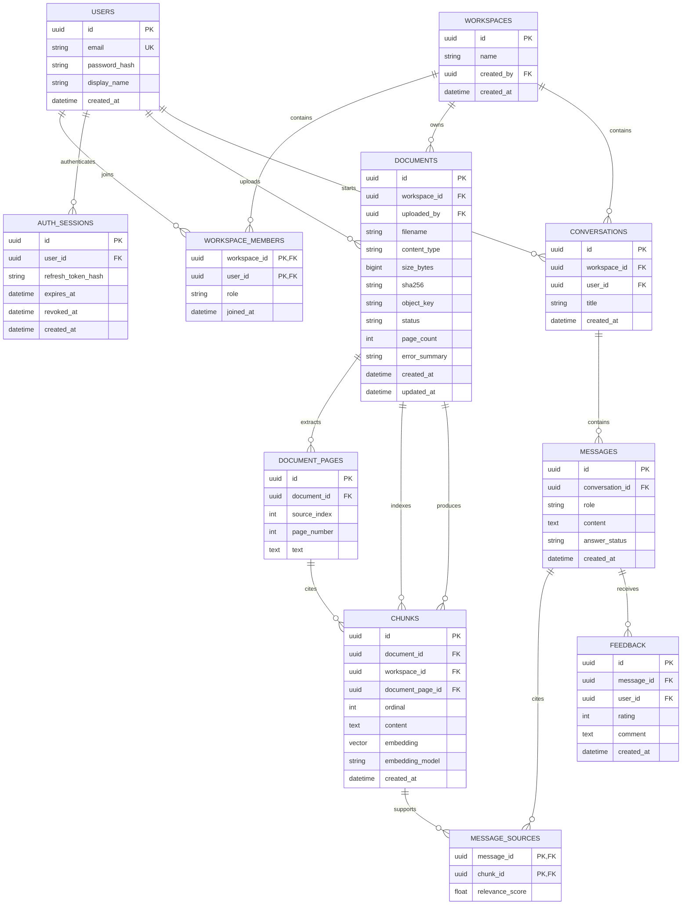

# Initial data model

PostgreSQL is the system of record. Use UUID primary keys, UTC timestamps, foreign keys, and indexes on common ownership and lookup paths. Store original file bytes in object storage; retain only the object key and metadata in PostgreSQL.

## Constraints and indexes to implement

- Unique normalized email for each user.
- One membership row per `(workspace_id, user_id)`; roles initially `owner`, `editor`, and `viewer`.
- One chunk ordinal per document; `page_number` is nullable for formats without reliable pages, while `source_index` remains available.
- Restrict message roles to `user` and `assistant`; assistant messages may be `answered` or `insufficient_evidence`.
- Index workspace IDs on documents, chunks, and conversations. Add a pgvector index only after choosing the distance operator and validating it with representative data.
- Ensure source links can only reference chunks belonging to the conversation's workspace; enforce through service validation and, if practical, composite database constraints.
- Use Alembic migrations for all schema changes.

## Notes

Conversation records belong to their creating user and workspace. Message-source rows retain the chunk relevance score returned during retrieval; deleting a source chunk cascades its citation row. This is an evolving model; retention and conversation export remain open product decisions.
